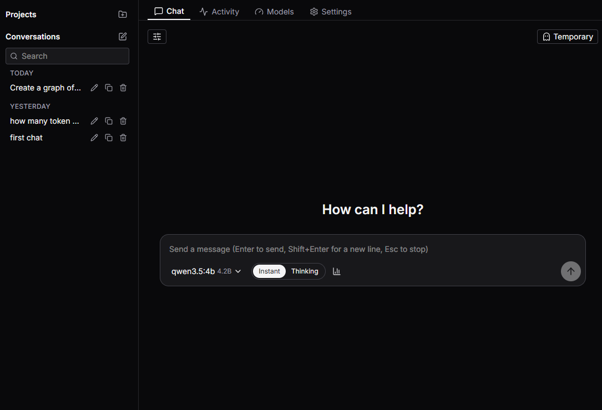
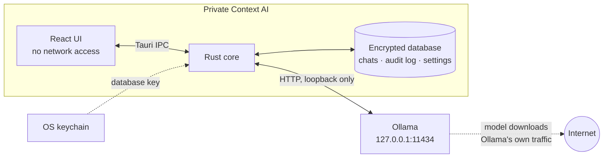

<p align="center">
  
</p>

<h1 align="center">Private Context AI</h1>

<p align="center">
  A private desktop chat app for local AI models.<br>
  Your prompts go to <a href="https://ollama.com">Ollama</a> on this computer and nowhere else.
</p>

<p align="center">
  
</p>

## Features

- **Local chat** with any model you have pulled into Ollama, streamed as it is written.
- **Encrypted history.** Saved chats are kept in an encrypted database on your disk.
- **Temporary chats.** Their text stays in the app's memory and is never written to
  disk. Their request metadata still shows in Activity.
- **Projects** with shared instructions and an automatic memory of the project's
  other chats, which you can view, edit and turn off.
- **Compare models.** Ask several models the same question side by side, then continue
  with one.
- **Charts and thinking**, both off by default: let a model draw a bar, line or pie
  chart, or show its reasoning.
- **Markdown replies** with code highlighting, copy buttons and Copy as Markdown.
- **Activity** lists every request the app made. **Models** shows each model's speed.
- **Search** across your chats, plus System, Light and Dark themes.

## How it works



The window has no network access of its own. Only the Rust core talks to Ollama, and
only on this computer. Ollama itself is a separate program: it downloads models and may
check for updates, but that traffic is Ollama's, not this app's.

## Security at a glance

- **No network but Ollama on loopback.** A strict CSP blocks the window from the
  network. Rust refuses non-loopback hosts, proxies and redirects, and it is built
  without TLS, so it cannot speak HTTPS at all.
- **Encrypted at rest.** Chats live in a SQLCipher database. Its key is kept in the
  OS keychain and never reaches the window.
- **Every request is audited.** A row is written to the audit log before each request
  goes out; if that fails, the request is refused.
- **Logs hold no content.** Only metadata such as request kinds, counts and timings.
- **The model cannot act.** It gets at most one display-only chart tool. Replies render
  without raw HTML, and links and images are inert.

What it does not protect against: Ollama itself, malware running as you, the
clipboard and the screen. Read [docs/security.md](docs/security.md) for the full model
and threat notes.

## Quick start

You need Node.js 26 (exact version in `.nvmrc`), pnpm 12 (exact version in `packageManager`),
Rust (rustup) and [Ollama](https://ollama.com). Node.js 26 no longer bundles Corepack, so
install it once with `npm install -g corepack && corepack enable`.
Start Ollama first: open the Ollama app, or run `ollama serve` in its own terminal.

```bash
pnpm install
ollama pull llama3.2             # any model works
pnpm --filter desktop dev        # open the app
pnpm --filter desktop build:app  # build installers
```

Platform setup (WebView2, webkit2gtk, SQLCipher build tools, WSL) and every repo
command are in [docs/development.md](docs/development.md).

### Keyboard

| Key         | In the chat                    |
| ----------- | ------------------------------ |
| Enter       | Send the message               |
| Shift+Enter | New line                       |
| Esc         | Stop the reply being generated |

Esc works wherever focus is in the chat, except in the sidebar's rename field and in a
message being edited, where it cancels the rename or the edit. In the message editor,
Enter saves and resends.

## Your data

Saved chats, the audit log and settings live in one encrypted database in the app data
folder, with its key in the OS keychain. Log files hold metadata only.
[docs/data.md](docs/data.md) lists the folders and files, and explains how to wipe
everything.

## Docs

- [Security model and threat notes](docs/security.md)
- [Where your data lives](docs/data.md)
- [Development, building and commands](docs/development.md)
